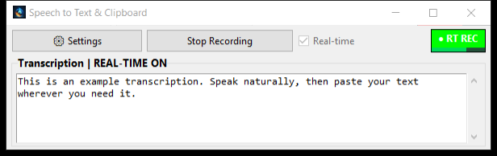
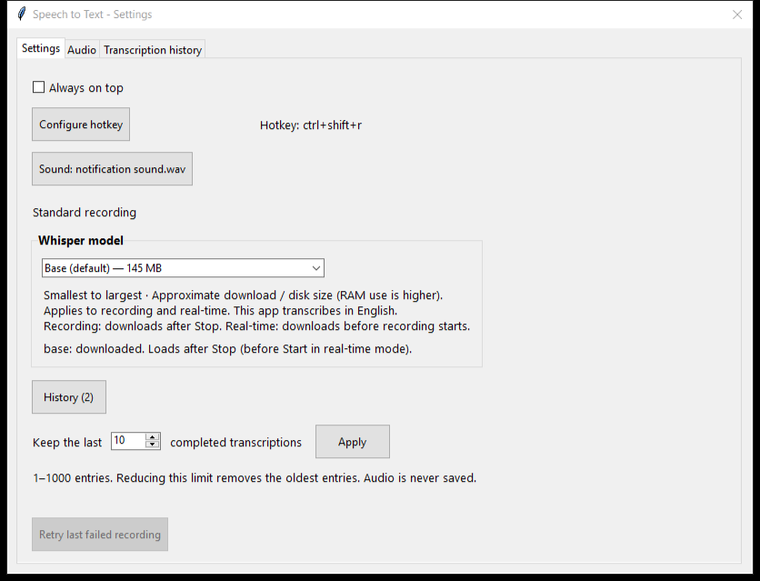
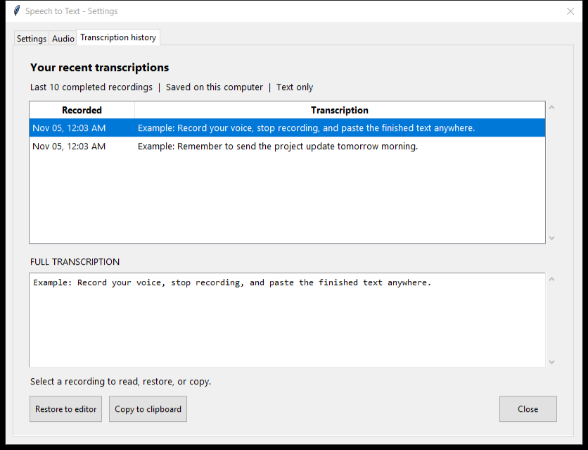

# STT Clipboard

Record your voice, stop recording, and paste the transcription anywhere. Runs locally with Whisper and copies the finished text straight to your clipboard.



## Run

Windows and Python 3.10. Keep `STT_to_clipboard.py`, `stt_Clipboard.ico`, and `notification sound.wav` together. Install dependencies once, then launch:

```powershell
python -m pip install torch==2.8.0 --index-url https://download.pytorch.org/whl/cu126
python -m pip install -r requirements.txt
python STT_to_clipboard.py
```

If compatible dependencies are already installed, just run the last command. A compatible NVIDIA GPU is used when available.

Choose your microphone in **Settings → Audio**, click **Start Recording**, speak, then click **Stop Recording**. Paste your text with **Ctrl+V**.

## Features

- Standard recording or continuous real-time transcription.
- Microphone selection and an input meter with a **QUIET** warning.
- Text history: last **10** by default, configurable from **1–1000**.
- Multiple Whisper models, listed by size; **Base** is the default.
- Resizable window, configurable hotkey, always-on-top, and retry after a failed transcription.

Models download on first use: after Stop in standard mode, before recording in real-time. They are reused from `%USERPROFILE%\.cache\whisper`. Supports English transcription.

Settings and text history are saved beside the script. Audio stays in memory and is discarded when the app closes.

<details>
<summary>Settings and history screenshots (example text)</summary>





</details>

[MIT License](LICENSE.txt)
